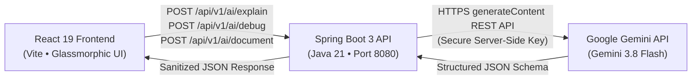

<div align="center">

# DevNest Labs
### AI-Powered Developer Workspace

[](https://spring.io/projects/spring-boot)
[](https://www.oracle.com/java/)
[](https://react.dev/)
[](https://vitejs.dev/)
[](https://ai.google.dev/)
[](LICENSE)

**An intelligent developer workspace engineered to solve the three core daily bottlenecks: understanding unfamiliar source code, debugging cryptic errors, and generating enterprise technical documentation.**

[Explore Architecture](docs/ARCHITECTURE.md) • [REST API Spec](docs/API_SPECIFICATION.md) • [Deployment Guide](docs/DEPLOYMENT_GUIDE.md)

</div>

---

## 🌟 The Three Core Problems We Solve

| Feature | Developer Problem | DevNest Labs Solution |
|---|---|---|
| **📖 Explain Code** | Tracing hundreds of lines of legacy or unfamiliar code by hand wastes hours. | Generates structured summaries, execution step flows, parameter impacts, and edge case alerts tailored to beginner, intermediate, or advanced levels. |
| **🐞 Debug Error** | Cryptic stack traces and NullPointerExceptions are painful to diagnose. | Analyzes the error alongside source code, ranks probable root causes, synthesizes corrected code snippets, and provides verification steps. |
| **📝 Generate Docs** | Writing repetitive Javadoc, Python docstrings, and Markdown specs is tedious. | Automatically extracts signatures, contracts, exceptions, and usage examples into standards-compliant documentation blocks. |

---

## 🏗️ Architecture & Communication Flow



> **Security First:** The frontend never handles Gemini API keys. All credentials reside strictly in backend server environment variables (`GEMINI_API_KEY` or `GOOGLE_API_KEY`), protected behind Spring Boot CORS, validation, and error sanitization filters.

---

## 🚀 Quickstart Guide

### 1. Prerequisites
- **Java 21 LTS** (`java -version`)
- **Maven 3.9+** (`mvn -v`)
- **Node.js 20+** & **npm** (`node -v`)

### 2. Start the Backend API (Spring Boot)
```powershell
cd backend

# (Optional) Export your Google Gemini API Key
$env:GEMINI_API_KEY="AIzaSy..."

# Run Spring Boot
mvn spring-boot:run
```
The REST API will be available at `http://localhost:8080/api/v1/health`.

### 3. Start the Frontend Workspace (React + Vite)
```powershell
cd frontend
npm install
npm run dev
```
Open **`http://localhost:5173`** in your browser to launch the DevNest Labs workspace.

---

## 🛡️ Enterprise Security & Reliability

1. **Zero Secret Leakage:** No API secrets are exposed in browser bundles or client network logs.
2. **Prompt Sandboxing:** User-submitted source code and error messages are delimited using strict boundary tags (`<<<CODE_START>>> ... <<<CODE_END>>>`) to mitigate prompt injection.
3. **Payload Bounds:** Automatic validation limits inputs to prevent denial-of-service memory exhaustion.
4. **Resilient Parsing:** Intelligent JSON parser strips extraneous formatting and guarantees clean client responses.
5. **No Remote Execution:** Code is analyzed purely semantically; user-submitted code is never executed on the host runtime.

---

## 🧪 Testing & Verification

Run the full automated backend test suite:
```powershell
cd backend
mvn test
```
**Test Coverage:**
- `GET /api/v1/health` — Verifies service status, active model (`gemini-3.8-flash`), and uptime.
- `POST /api/v1/ai/explain` — Verifies structured response mapping and semantic breakdown.
- `POST /api/v1/ai/debug` — Verifies error cause ranking and corrected code generation.
- `POST /api/v1/ai/document` — Verifies Javadoc and Markdown doc generation.
- Validation bounds checking — Confirms 400 Bad Request error responses on invalid/blank inputs.

---

## 📁 Repository Structure

```
devnestlabs/
├── frontend/                     # React 19 + Vite Application
│   ├── src/
│   │   ├── components/           # UI Components (Editor, Results, Tabs, Modals)
│   │   ├── pages/                # Home Overview & Workspace views
│   │   ├── services/             # Spring Boot REST API client
│   │   ├── index.css             # Tailored Dark Theme & Design System
│   │   └── App.jsx
│   ├── index.html
│   └── package.json
├── backend/                      # Java 21 + Spring Boot 3 API
│   ├── src/main/java/com/devnest/
│   │   ├── controller/           # AiController & HealthController
│   │   ├── service/              # GeminiService & Offline Fallback Engine
│   │   ├── config/               # CorsConfig & GeminiProperties
│   │   ├── dto/                  # Request & Response Records
│   │   └── exception/            # GlobalExceptionHandler
│   ├── src/main/resources/       # application.yml
│   ├── src/test/java/com/devnest/# Automated Integration Test Suite
│   └── pom.xml
├── docs/                         # Project Specifications
│   ├── ARCHITECTURE.md           # Detailed architecture breakdown
│   ├── API_SPECIFICATION.md      # OpenAPI/REST endpoints contract
│   └── DEPLOYMENT_GUIDE.md       # Production hosting & DNS guide
├── .gitignore
├── LICENSE                       # MIT License
└── README.md
```

---

## 📄 License
This project is licensed under the [MIT License](LICENSE).
DevNest Labs © 2026. Built with React, Spring Boot, and Google Gemini API.
