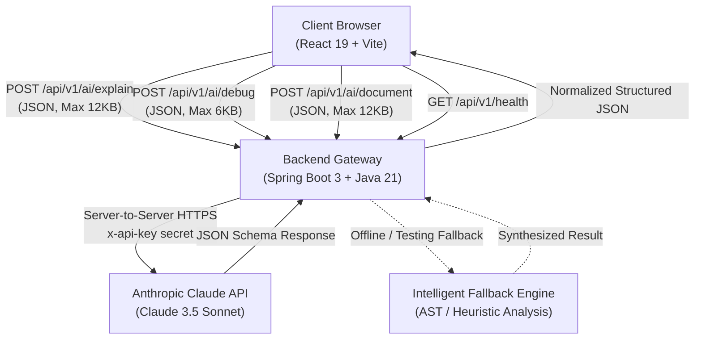

# DevNest Labs — Architecture & Engineering Specification

## 1. Executive Overview

DevNest Labs is a production-engineered developer workspace designed to streamline comprehension of unfamiliar codebases, triage and debug runtime exceptions, and automate enterprise-grade technical documentation. 

The application implements a decoupled, modern three-tier architecture:
1. **Client Tier:** React 19 + Vite SPA with custom design system, glassmorphic UI, and syntax-aware controls.
2. **API & Orchestration Tier:** Java 21 + Spring Boot 3 REST API providing input validation, prompt sandboxing, rate guarding, and resilient parsing.
3. **AI Inference Tier:** Anthropic Claude API (Claude 3.5 Sonnet) invoked server-to-server with strict credential segregation.

---

## 2. Architecture Diagram

---

## 3. Core Component Roles

### 3.1 Client Tier (React 19 + Vite)
- **State Management:** Manages active feature modes (`explain`, `debug`, `document`), responsive inputs, formatted outputs, and history drawer.
- **Local Persistence:** Preserves past inquiries locally in browser `localStorage` without leaking code to third parties.
- **Security Guarantee:** Never bundles Anthropic API keys or backend credentials into client JavaScript bundles.
- **Micro-Interactions:** Provides copy tooltips, keyboard shortcuts (`Ctrl + Enter`), loading spinners with rotating tips, and markdown file export.

### 3.2 Backend Tier (Java 21 + Spring Boot 3)
- **AiController:** Exposes versioned REST endpoints (`/api/v1/ai/explain`, `/api/v1/ai/debug`, `/api/v1/ai/document`).
- **ClaudeService:** Implements Anthropic Messages API v1 protocol using Java 21 native `HttpClient`. Uses prompt delimitation (`<<<CODE_START>>> ... <<<CODE_END>>>`) to mitigate prompt injection.
- **Resilient JSON Parser:** Cleans backticks, extracts root JSON structures, and gracefully falls back to structured output if unexpected formats are encountered.
- **Offline / Sandbox Mode:** Automatically engages intelligent local analysis if `ANTHROPIC_API_KEY` is omitted, allowing seamless testing and local demo execution.
- **GlobalExceptionHandler:** Sanitizes server exceptions, preventing exposure of stack traces, internal paths, or credentials.

### 3.3 Security & Reliability Measures
| Concern | Implementation |
|---|---|
| **Credential Safety** | API keys stored strictly in server environment variables (`ANTHROPIC_API_KEY` / `CLAUDE_API_KEY`). |
| **Prompt Injection** | User code and stack traces are enclosed within isolated boundary delimiters. |
| **DoS / Memory Guard** | Strict character limits enforced via `@Size` validation (12,000 chars code, 6,000 chars errors). |
| **CORS Restriction** | Whitelists only authorized origins (`http://localhost:5173`, `https://devnestlabs.shop`). |
| **No Remote Execution** | Code is analyzed purely semantically. No submitted code is ever executed on server runtimes. |
